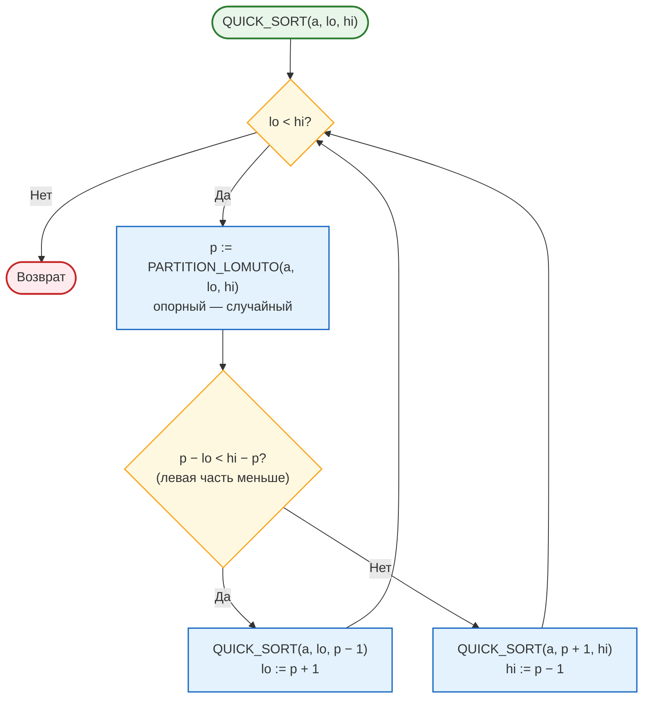
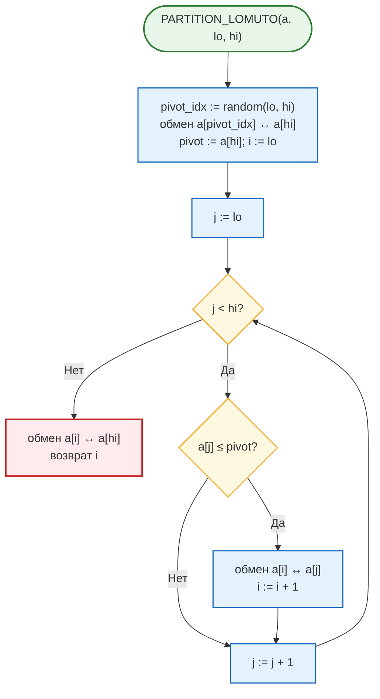
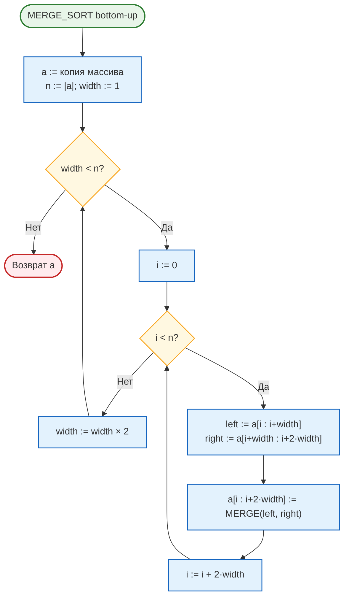
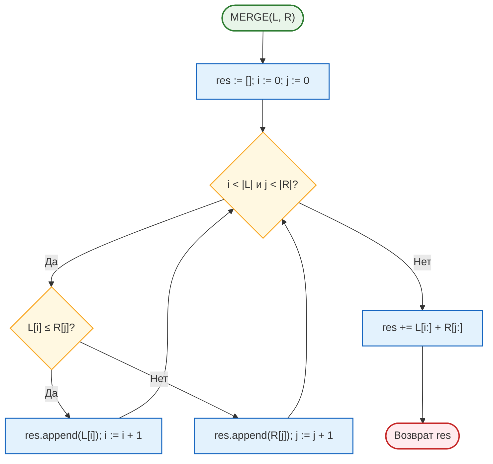

# Лабораторная работа № 3

**Эмпирический анализ временной сложности алгоритмов сортировки.**  
**Часть 2: алгоритмы на основе парадигмы «разделяй и властвуй»**  
**(быстрая сортировка и сортировка слиянием)**

| | |
|---|---|
| **Дисциплина** | Основы алгоритмизации и программирование |
| **Направление** | 38.03.05 «Бизнес-информатика» |
| **Курс** | 2 |
| **Группа** | БИ 2-1 |
| **Выполнила** | Осипова Анна Алексеевна |
| **Вариант** | 17 |
| **Язык реализации** | Python 3.10+ |
| **Год** | 2026 |

---

## 1. Цель работы

Изучить рекурсивные алгоритмы сортировки, построенные по принципу «разделяй и властвуй», экспериментально подтвердить их сложность \(O(n \log n)\) и провести сравнительный анализ с квадратичными алгоритмами из лабораторной работы № 2.

**Задачи:**

1. Изучить парадигму «разделяй и властвуй» и метод анализа рекуррентных соотношений.
2. Реализовать быструю сортировку (Quick Sort) и сортировку слиянием (Merge Sort) согласно варианту.
3. Сравнить четыре алгоритма (пузырьком, вставками, быструю, слиянием) на общем наборе размеров.
4. Сравнить быструю сортировку и сортировку слиянием на больших массивах и на данных различной структуры; использовать `sorted()` как эталон.
5. Выполнить дополнительное задание Г5.

---

## 2. Задание варианта 17

| Параметр | Значение |
|---|---|
| Опорный элемент | **Сл** — случайный |
| Схема разбиения | **Л** — Ломуто |
| Сортировка слиянием | **В** — восходящая (bottom-up) |
| Размеры \(n\) (эксперимент 2) | 30 000; 60 000; 120 000; 240 000 |
| Дополнительное задание | **Г5** — устойчивость на записях `(регион, выручка)` |

Используются функции `bubble_sort`, `insertion_sort` из ЛР № 2 и модуль `sorts_common.py`.

---

## 3. Теоретическая часть

### 3.1. Парадигма «разделяй и властвуй»

Метод предполагает три этапа:

1. **Разделение** — задача разбивается на подзадачи меньшего размера того же типа.
2. **Властвование** — подзадачи решаются рекурсивно; достаточно малые — непосредственно (базовый случай).
3. **Комбинирование** — решения подзадач объединяются в решение исходной задачи.

Трудоёмкость описывается рекуррентным соотношением

\[
T(n) = a \cdot T\!\left(\frac{n}{b}\right) + f(n).
\]

При \(a = b = 2\) и \(f(n) = \Theta(n)\) по основной теореме (master theorem)

\[
T(n) = \Theta(n \log n).
\]

Интуитивно: дерево рекурсии имеет \(\approx \log_2 n\) уровней, на каждом суммарно \(\Theta(n)\) операций.

### 3.2. Нижняя оценка для сортировок сравнением

Любой алгоритм, упорядочивающий элементы только попарными сравнениями, в худшем случае выполняет \(\Omega(n \log n)\) сравнений (модель дерева решений: \(\ge n!\) листьев ⇒ высота \(\Theta(n \log n)\)). Сортировка слиянием **асимптотически оптимальна** среди сортировок сравнением.

### 3.3. Сортировка слиянием (восходящая, bottom-up)

Восходящая версия не использует рекурсию: сливает пары элементов, затем блоки длины 2, 4, 8 и т. д.

- На каждом уровне — \(\Theta(n)\) операций, число уровней — \(\lceil\log_2 n\rceil\).
- \(T(n) = \Theta(n \log n)\) **во всех случаях**.
- Дополнительная память — \(\Theta(n)\).
- Сравнение `left[i] <= right[j]` обеспечивает **устойчивость**.

### 3.4. Быстрая сортировка (Ломуто, случайный опорный)

- **Разделение:** выбирается случайный опорный элемент, массив переупорядочивается схемой Ломуто.
- **Властвование:** обе части сортируются рекурсивно (рекурсия — только в меньшую часть, глубина стека \(O(\log n)\)).
- **Комбинирование:** не требуется (сортировка на месте).

**Схема Ломуто:** опорный ставится в конец подмассива; один указатель \(i\) отмечает границу «левой» части.

**Оценки:**

| Случай | Сложность |
|---|---|
| Лучший / средний | \(\Theta(n \log n)\) |
| Худший | \(\Theta(n^2)\) |

Случайный опорный даёт **ожидаемое** время \(\Theta(n \log n)\) для любых входных данных. Сортировка **неустойчива**, доп. память \(O(\log n)\).

### 3.5. Сводная характеристика

| Алгоритм | Лучший | Средний | Худший | Память | Устойчивость |
|---|---|---|---|---|---|
| Пузырьком | \(\Theta(n)\) | \(\Theta(n^2)\) | \(\Theta(n^2)\) | \(O(1)\) | Да |
| Вставками | \(\Theta(n)\) | \(\Theta(n^2)\) | \(\Theta(n^2)\) | \(O(1)\) | Да |
| Слиянием (В) | \(\Theta(n \log n)\) | \(\Theta(n \log n)\) | \(\Theta(n \log n)\) | \(\Theta(n)\) | Да |
| Быстрая (Сл, Л) | \(\Theta(n \log n)\) | \(\Theta(n \log n)\) | \(\Theta(n^2)\) | \(O(\log n)\) | Нет |
| `sorted()` / Timsort | \(\Theta(n)\) | \(\Theta(n \log n)\) | \(\Theta(n \log n)\) | \(O(n)\) | Да |

---

## 4. Блок-схемы алгоритмов (Mermaid)

### 4.1. Быстрая сортировка



*Рисунок 1 — Блок-схема быстрой сортировки (рекурсия в меньшую часть)*

### 4.2. Разбиение Ломуто со случайным опорным



*Рисунок 2 — Блок-схема PARTITION (схема Ломуто)*

### 4.3. Восходящая сортировка слиянием



*Рисунок 3 — Блок-схема bottom-up merge sort*

### 4.4. Процедура MERGE



*Рисунок 4 — Блок-схема слияния двух упорядоченных массивов*

---

## 5. Листинг программы

### 5.1. Быстрая сортировка (вариант 17)

```python
def quick_sort(arr):
    a = arr.copy()
    _quick_sort(a, 0, len(a) - 1)
    return a


def _quick_sort(a, lo, hi):
    """Рекурсия в меньшую часть — глубина стека O(log n)."""
    while lo < hi:
        p = _partition_lomuto(a, lo, hi)
        if p - lo < hi - p:
            _quick_sort(a, lo, p - 1)
            lo = p + 1
        else:
            _quick_sort(a, p + 1, hi)
            hi = p - 1


def _partition_lomuto(a, lo, hi):
    """Схема Ломуто: случайный опорный меняется с a[hi]."""
    pivot_idx = random.randint(lo, hi)
    a[pivot_idx], a[hi] = a[hi], a[pivot_idx]
    pivot = a[hi]
    i = lo
    for j in range(lo, hi):
        if a[j] <= pivot:
            a[i], a[j] = a[j], a[i]
            i += 1
    a[i], a[hi] = a[hi], a[i]
    return i
```

### 5.2. Восходящая сортировка слиянием

```python
def merge_sort(arr):
    a = arr.copy()
    n = len(a)
    width = 1
    while width < n:
        for i in range(0, n, 2 * width):
            left = a[i : i + width]
            right = a[i + width : i + 2 * width]
            a[i : i + 2 * width] = _merge(left, right)
        width *= 2
    return a


def _merge(left, right):
    result = []
    i = j = 0
    while i < len(left) and j < len(right):
        if left[i] <= right[j]:      # «<=» обеспечивает устойчивость
            result.append(left[i])
            i += 1
        else:
            result.append(right[j])
            j += 1
    result.extend(left[i:])
    result.extend(right[j:])
    return result
```

Полный код экспериментов — в файлах `lr3.py`, `lr2.py`, `sorts_common.py`.

---

## 6. Характеристики вычислительной системы

Измерения выполнены на удалённом стенде (Linux, Python 3.10+).  
Таймер — `time.perf_counter()`, итог — **медиана из 3 повторов**.  
Абсолютные значения зависят от конкретной системы.

---

## 7. Результаты измерений

### 7.1. Эксперимент 1 — четыре алгоритма (случайные данные)

| \(n\) | Пузырьком, с | Вставками, с | Быстрая, с | Слиянием, с |
|------:|-------------:|-------------:|-----------:|------------:|
| 1000  | 0,0334       | 0,0133       | 0,0010     | 0,0014      |
| 2000  | 0,1353       | 0,0547       | 0,0023     | 0,0027      |
| 3000  | 0,2974       | 0,1213       | 0,0033     | 0,0040      |
| 4000  | 0,5307       | 0,2191       | 0,0050     | 0,0057      |
| 5000  | 0,8537       | 0,3368       | 0,0057     | 0,0072      |

При \(n = 5000\) быстрая сортировка быстрее пузырьковой примерно в **150 раз**, сортировки вставками — примерно в **59 раз**.

### 7.2. Эксперимент 2 — \(O(n \log n)\) на больших массивах

| \(n\)    | Быстрая, с | Слиянием, с | `sorted()`, с | Слияние / Быстрая |
|---------:|-----------:|------------:|--------------:|------------------:|
| 30 000   | 0,0450     | 0,0508      | 0,0045        | 1,13              |
| 60 000   | 0,0886     | 0,1103      | 0,0101        | 1,24              |
| 120 000  | 0,1890     | 0,2435      | 0,0222        | 1,29              |
| 240 000  | 0,4393     | 0,7275      | 0,0570        | 1,66              |

### 7.3. Проверка роста \(T(2n)/T(n)\)

| Переход              | Быстрая | Слиянием | Теория \(O(n \log n)\) | Теория \(O(n^2)\) |
|----------------------|--------:|---------:|-----------------------:|------------------:|
| 30 000 → 60 000      | 1,97    | 2,17     | ≈ 2,12                 | 4                 |
| 60 000 → 120 000     | 2,13    | 2,21     | ≈ 2,11                 | 4                 |
| 120 000 → 240 000    | 2,32    | 2,99     | ≈ 2,10                 | 4                 |

Теоретическое значение:

\[
\frac{T(2n)}{T(n)} \approx \frac{2\log(2n)}{\log n}.
\]

Отношения близки к ≈ 2,1 и далеки от 4. На переходе 120k → 240k у слияния отношение выше из‑за накладных расходов Python на создание списков.

### 7.4. Эксперимент 3 — структура данных (\(n = 50\,000\))

| Тип данных                  | Быстрая, с | Слиянием, с |
|-----------------------------|-----------:|------------:|
| Случайные (R)               | 0,0769     | 0,1000      |
| Упорядоченные (S)           | 0,0652     | 0,0598      |
| Обратно упорядоченные (V)   | 0,0691     | 0,0572      |
| Почти упорядоченные (N)     | 0,0663     | 0,0790      |
| Много повторов (D)          | **7,1309** | 0,0799      |

На данных типа **D** схема Ломуто деградирует: почти все элементы попадают в одну часть разбиения, время близко к \(\Theta(n^2)\). Случайный опорный не спасает при доминировании равных ключей. Сортировка слиянием сохраняет \(\Theta(n \log n)\) на всех типах.

---

## 8. Дополнительное задание Г5

Сортировка записей вида `(регион, выручка)` **по выручке**. Проверяется сохранение относительного порядка регионов с одинаковой выручкой.

| Исходные          | Merge sort        | Quick sort        |
|-------------------|-------------------|-------------------|
| Север — 1000      | Юг — 500          | Юг — 500          |
| Юг — 500          | Запад — 750       | Запад — 750       |
| Восток — 1000     | **Север — 1000**  | **Восток — 1000** |
| Запад — 750       | **Восток — 1000** | **Север — 1000**  |
| Центр — 1000      | **Центр — 1000**  | **Центр — 1000**  |

Порядок записей с выручкой 1000 в исходном списке: **Север → Восток → Центр**.

- **Merge sort** сохранил этот порядок → **устойчива**.
- **Quick sort** изменил порядок (Север и Восток поменялись) → **неустойчива**.

**Вывод:** для многоуровневой сортировки отчётов (сначала по выручке, затем по региону) пригодна только устойчивая сортировка — слияние или Timsort (`sorted()`). Быстрая сортировка для таких задач не подходит.

---

## 9. Сводная сравнительная таблица

| Алгоритм   | Ср. сложность   | \(t\) (\(n=5000\)), с | Ускорение* | Память     | Устойч. |
|------------|-----------------|----------------------:|-----------:|------------|---------|
| Пузырьком  | \(\Theta(n^2)\) | 0,8537                | 1          | \(O(1)\)   | Да      |
| Вставками  | \(\Theta(n^2)\) | 0,3368                | 2,5        | \(O(1)\)   | Да      |
| Слиянием   | \(\Theta(n\log n)\) | 0,0072            | 119        | \(\Theta(n)\) | Да   |
| Быстрая    | \(\Theta(n\log n)\) | 0,0057            | 150        | \(O(\log n)\) | Нет  |

\* Ускорение относительно пузырьковой сортировки при \(n = 5000\).

---

## 10. Выводы

1. Эксперимент подтвердил различие классов сложности: при \(n = 5000\) алгоритмы \(O(n \log n)\) быстрее квадратичных в 50–150 раз; на логарифмическом графике кривые квадратичных алгоритмов растут заметно круче.

2. Для быстрой сортировки и сортировки слиянием отношение \(T(2n)/T(n)\) составляет примерно 2,0–2,3, что соответствует \(\Theta(n \log n)\) и существенно отличается от 4.

3. Быстрая сортировка (случайный опорный, Ломуто) на случайных данных стабильно опережает восходящую сортировку слиянием. На данных с большим числом повторов схема Ломуто деградирует — известное ограничение, устраняемое трёхпутевым разбиением (голландский флаг).

4. Случайный опорный элемент защищает быструю сортировку от вырождения на упорядоченных и обратно упорядоченных массивах.

5. Задание **Г5:** сортировка слиянием устойчива, быстрая — нет. Для многоуровневой сортировки отчётов следует использовать устойчивый алгоритм (слияние или `sorted()`).

6. Встроенная `sorted()` работает в 7–12 раз быстрее собственных реализаций благодаря реализации на C и гибридному Timsort. В прикладных системах рекомендуется использовать стандартную библиотеку.

---

## 11. Контрольные вопросы

**1. Три этапа «разделяй и властвуй» на примере слияния.**  
Разделение — деление массива на блоки `width`. Властвование — итеративная сортировка частей. Комбинирование — процедура `MERGE`.

**2. Рекуррентность сортировки слиянием.**  
\(T(n) = 2\,T(n/2) + \Theta(n)\). Дерево рекурсии: \(\log_2 n\) уровней, на каждом \(\Theta(n)\) → \(\Theta(n \log n)\).

**3. Нижняя оценка \(\Omega(n \log n)\).**  
Дерево решений должно иметь \(\ge n!\) листьев, высота \(\ge \log_2(n!) = \Theta(n \log n)\).

**4. Худшие данные для опорного «первый».**  
Уже упорядоченный или обратно упорядоченный массив: разбиения \(0 : n-1\), \(T(n) = \Theta(n^2)\).

**5. Ломуто и Хоар.**  
Ломуто — один указатель, опорный в конце, больше обменов. Хоар — два указателя навстречу, меньше обменов, быстрее на практике.

**6. Рандомизация опорного.**  
Ожидаемое время \(\Theta(n \log n)\) для любого входа; вероятность худшего случая ничтожна.

**7. Почему быстрая часто быстрее слияния.**  
Меньшая константа, работа на месте, лучшая локальность кэша.

**8. Глубина рекурсии \(O(\log n)\).**  
Рекурсивно обрабатывать меньшую часть, большую — в цикле `while`.

**9. Устойчивость.**  
Слияние: сравнение `≤` не меняет порядок равных. Быстрая: обмены нарушают порядок.

**10. Timsort.**  
Выделяет уже упорядоченные runs и сливает их; для коротких — вставками. Адаптивен и устойчив.

---

## 12. Рекомендуемая литература

1. Кормен Т., Лейзерсон Ч., Ривест Р., Штайн К. Алгоритмы: построение и анализ. — 3-е изд. — М.: Вильямс, 2013.
2. Седжвик Р., Уэйн К. Алгоритмы на Java. — 4-е изд. — М.: Вильямс, 2013.
3. Hoare C. A. R. Quicksort // The Computer Journal. — 1962. — Vol. 5, No. 1. — P. 10–16.
4. Кнут Д. Э. Искусство программирования. Т. 3. Сортировка и поиск. — 2-е изд. — М.: Вильямс, 2017.
5. Бхаргава А. Грокаем алгоритмы. — 2-е изд. — СПб.: Питер, 2024.
6. Peters T. Timsort description — https://github.com/python/cpython/blob/main/Objects/listsort.txt

---

*Лабораторная работа № 3 • Осипова Анна Алексеевна • Вариант 17 • 2026*
